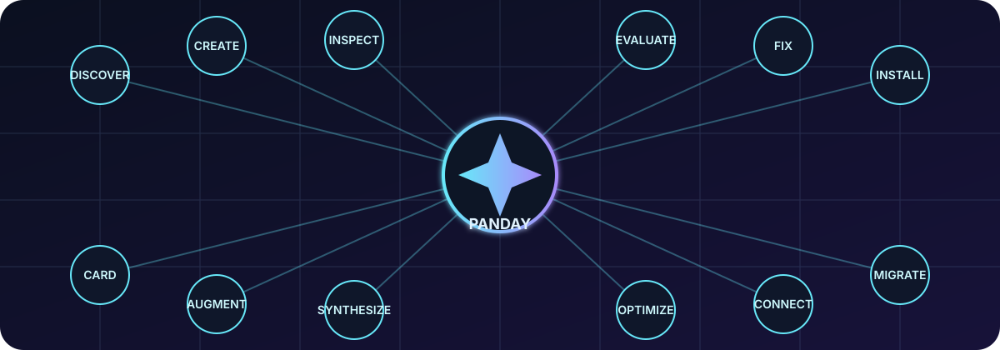

# Panday

### A governed skill system for agents that need to discover, build, inspect, measure, evolve, and move capabilities safely.

Panday is a standalone, composable ecosystem of 12 agent skills, a Python
standard-library CLI, and versioned lifecycle records. It is designed for the
real workflow around skills—not just authoring a `SKILL.md`, but finding the
right capability, checking trust boundaries, evaluating outcomes, repairing
failures, installing exact bytes, and preserving evidence as the system grows.



## Why Panday

Most skill collections stop at “here is a prompt.” Panday treats a skill as a
maintained product with a contract, resources, tests, provenance, and an owner.
Each capability works by itself, while explicit lifecycle records make safe
composition possible when a workflow spans more than one skill.

- **Standalone first** — every skill has a complete local workflow and a
  manual fallback; no Habi runtime, remote service, or umbrella orchestrator is
  required.
- **Composable by evidence** — optional versioned records carry fingerprints,
  findings, dispositions, and handoffs without silently granting authority.
- **Security-aware** — inspection is source-aware and read-only; install and
  migration are preview-first and fingerprint-bound; candidate code is not
  executed by the CLI.
- **Measurable** — evaluation supports assertion-level evidence, paired runs,
  holdouts, process audits, uncertainty, and explicit `ALLOW`/`HOLD`/`BLOCK`
  gates.
- **Portable** — the CLI uses Python’s standard library, while the skills are
  ordinary folders that can be hosted by Codex, Habi, or another compatible
  agent host.

## The 12 capabilities

| Skill | What it does | Typical handoff |
| --- | --- | --- |
|  **Discover** | Find, qualify, and compare existing installable skills. | Inspect or Install |
|  **Create** | Turn a task, document, or conversation pattern into a reusable skill. | Inspect or Evaluate |
|  **Inspect** | Review exact skill bytes for security, trust, scope, and installability. | Install, Fix, or Card |
|  **Evaluate** | Build evals, run benchmarks, score evidence, and apply gates. | Fix, Card, or Optimize |
|  **Fix** | Repair a broken or high-frequency failure while preserving regressions. | Evaluate |
|  **Install** | Preview and apply an authorized skill with byte verification. | Inspect or Card |
|  **Card** | Render an evidence-linked governance and release summary. | Review or Handoff |
|  **Augment** | Add a justified capability without losing the existing contract. | Evaluate |
|  **Synthesize** | Merge overlapping skills while retaining each useful behavior. | Inspect or Evaluate |
|  **Optimize** | Find a better path for a specific measured task. | Evaluate |
|  **Connect** | Define an explicit workflow between independent skills. | Evaluate or Card |
|  **Migrate** | Convert a selected skill between supported agent platforms. | Inspect or Evaluate |

## Install

The repository intentionally provides both an uncompressed source tree and a
versioned ZIP artifact:

- Use the **source tree** for browsing, pull requests, auditing, and packaging.
- Use the **ZIP** for a small, reproducible distribution download and for the
  one-line installers.

Both routes contain the same release-validated package contents.

### Windows PowerShell

```powershell
irm https://raw.githubusercontent.com/GG-Santos/panday/main/install.bat -OutFile install.bat
.\install.bat
```

### macOS/Linux

```sh
curl -fsSL https://raw.githubusercontent.com/GG-Santos/panday/main/install.sh | sh
```

The installers require [`uv`](https://docs.astral.sh/uv/). They download the
package archive from the pinned v1.1.1 GitHub Release into a
persistent Panday home and install the CLI as an editable `uv` tool. Set these
environment variables to customize the defaults:

```text
PANDAY_REPO       GitHub owner/repository (default: GG-Santos/panday)
PANDAY_VERSION    GitHub release tag (default: v1.1.1)
PANDAY_ARCHIVE    release asset filename (default: panday-<tag>.zip)
PANDAY_HOME       extraction/install location
PANDAY_URL        complete archive URL override (POSIX installer only)
```

Verify the installation:

```sh
panday --version
panday --json doctor
```

Register the bundled skills in `~/.panday/config.toml` (or
`%USERPROFILE%\.panday\config.toml` on Windows):

```toml
version = 1

[registries]
paths = ["/path/to/panday/skills"]
```

Then discover them with:

```sh
panday skills list
panday skills show /path/to/panday/skills/panday-inspect
```

## CLI at a glance

The CLI is deterministic plumbing, not a replacement for skill judgment. It
does file, JSON, archive, provenance, discovery, evaluation, and lifecycle
operations; the host remains responsible for execution and authorization.

```text
panday skills search <query>
panday skills inspect <source> [--ref REF] [--subpath PATH]
panday skills install <source> --project <path> --preview
panday skills install <source> --project <path> --apply --fingerprint <preview-id>
panday skills migrate <source> --to codex|claude --target <path> --preview
panday eval validate <evals.json>
panday eval benchmark <results.jsonl> [--evals <evals.json>] [--policy <policy.json>]
panday eval gate <report.json> --policy <policy.json>
panday lifecycle fingerprint <skill-directory>
panday lifecycle validate-record <record.json>
panday lifecycle validate-chain <record.json> [...]
```

Human-readable output is the default; `--json` is stable machine-readable
output. Exit codes are documented in [`cli/README.md`](cli/README.md): `2` for
operation errors, `3` for policy blocks, and `4` for evidence holds or an empty
remote search.

## Architecture

```text
User intent
    |
    v
Discover ──> Inspect ──> Install ──> Card
    |             |
    v             v
Create ───────> Evaluate ──> Fix / Augment / Optimize
                              |
                    Synthesize / Connect / Migrate
                              |
                    versioned lifecycle evidence
```

The handoff protocol is optional. A skill invoked without a shared record still
returns a useful standalone result and names the missing evidence needed for a
composed transition. Changed fingerprints invalidate revision-bound findings;
held or incomplete evidence cannot silently become install authorization.

## Repository layout

```text
skills/       12 canonical panday-* skill packages
cli/          Python standard-library CLI, tests, and command reference
lifecycle/    v1/v2 schemas, validators, templates, and lifecycle tests
release/      validation summary; packaged .skill archives in release ZIP
docs/         implementation specification and acceptance evidence
assets/       architecture visual used by this README
```

Every skill package contains its own `SKILL.md`, agents, references, assets,
scripts, evals, tests, and `.skillignore`. Each `assets/icon.svg` uses a 64×64
rounded-square tile with a distinct glyph and an accessible name. The current
system is documented in [the icon design plan](docs/2026-11-27-panday-icons-v3-design.md).

Download [panday-v1.1.1.zip](https://github.com/GG-Santos/panday/releases/download/v1.1.1/panday-v1.1.1.zip)
from the release. Its README, installers, source files, and all twelve icons
match the release tag. The bundle version is v1.1.1; the unchanged CLI reports
its own implementation version, 0.1.0.

## Trust and release model

Panday does not turn a green structural check into a behavioral guarantee.
Release evidence is kept separate from runtime instructions and reports its
limits explicitly. The current package passed:

- 12/12 clean strict package validations and archive verification
- Skill Creator tooling: 55/55 tests
- Panday CLI: 22/22 tests
- Lifecycle records: 15/15 tests

Install and migration previews are bound to the exact candidate fingerprint.
The CLI never executes candidate skill code, and credentials are read only from
the host environment for explicitly requested source operations.

## Development

```sh
uv run --project cli panday --help
python -B -m unittest discover -s cli/tests -p 'test*.py'
python -B -m unittest discover -s lifecycle/tests -p 'test*.py'
```

For the full architecture, evidence matrix, and known limitations, read
[`docs/2026-11-24-habi-skill-capability-expansion-design.md`](docs/2026-11-24-habi-skill-capability-expansion-design.md).

The source tree is the canonical browsable/contributor surface. Versioned ZIPs
are kept in [GitHub Releases](https://github.com/GG-Santos/panday/releases),
not committed to `main`, so clones stay reviewable and release downloads stay
stable.
