# Panday

**Turn the way you work into skills your AI can reuse.**

You finally get your AI assistant to produce the report, review, or summary you wanted. Next week, you explain the same process again. Panday helps you turn that useful routine into a reusable skill—and gives you the tools to find, check, improve, and organize skills as your needs grow.

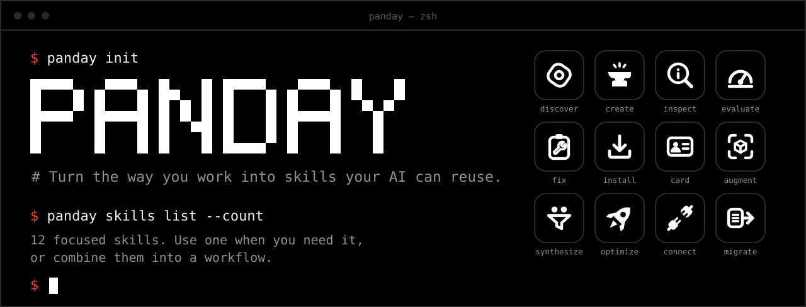

**12 focused skills. Use one when you need it, or combine them into a workflow.**

<p align="center">
  <a href="#install-panday"><strong>Install Panday</strong></a> &nbsp; / &nbsp;
  <a href="#choose-the-right-skill">Find your skill</a> &nbsp; / &nbsp;
  <a href="#the-12-panday-skills">Explore the collection</a> &nbsp; / &nbsp;
  <a href="#frequently-asked-questions">FAQ</a> &nbsp; / &nbsp;
  <a href="https://github.com/GG-Santos/panday/releases/latest">Download release</a>
</p>

## Project description

A skill is a set of reusable instructions and supporting materials for an AI assistant. Think of it as a recipe: it explains what to do, what ingredients are needed, what a good result looks like, and what to do when something is missing.

For example, a weekly update skill might turn your notes into a consistent report with achievements, blockers, and next steps. A meeting skill might extract decisions without inventing owners or deadlines. A review skill might check a document against your team's own checklist.

Panday helps you build and maintain those recipes. You describe the work in ordinary language; your assistant uses the appropriate Panday skill to guide the process.

- **Keep what works.** Capture a successful conversation or recurring task as a skill you can use again.
- **Start with something useful.** Search for existing skills before building another one.
- **Know what you are adding.** Review a downloaded skill's instructions, permissions, and supporting files.
- **Improve with a clear target.** Repair mistakes, add a capability, or compare different ways of completing the same task.
- **Organize growing workflows.** Combine overlapping skills or connect independent ones without losing their roles.
- **Understand your tools.** Produce readable skill summaries and prepare packages for another supported assistant.

| Capture your best work | Improve what you use | Build a connected toolkit |
| :--- | :--- | :--- |
| Turn a conversation, document, or recurring task into instructions your assistant can reuse. | Investigate failures, test changes, and add capabilities with a clear goal. | Find skills, understand their requirements, and define how they work together. |
| **Create · Discover · Card** | **Inspect · Evaluate · Fix · Augment · Optimize** | **Install · Synthesize · Connect · Migrate** |

Panday is useful for writers, researchers, operations teams, project leads, and anyone who repeatedly asks an AI assistant to follow a particular process. You do not need to write code to describe a workflow. Initial setup still depends on how your assistant supports local skills.

---

## Install Panday

| Route | Best for | Where to begin |
| :--- | :--- | :--- |
| **Skill folders** | Using Panday in your assistant | Download, extract, and add selected folders as described below. |
| **Optional helper** | Repeatable checks and command-line reports | Follow the [Windows or macOS/Linux setup](#optional-command-line-setup). |

**You need:** an AI assistant that supports local skill folders, access to its supported skill location, and an extracted Panday package. The helper has [additional requirements](#optional-command-line-setup).

### 1. Choose how you want to use Panday

**For everyday use, start with the skills.** Download the [latest release](https://github.com/GG-Santos/panday/releases/latest), extract the ZIP, and open its `skills` folder. Each `panday-*` folder is a separate skill. You can start with one or install all 12.

Add the selected folders to the skill directory supported by your AI assistant, following that assistant's installation instructions. Keep each complete folder together: its instructions can depend on the included references, templates, and scripts. Reload the assistant if its installation process requires it.

Panday is a skill collection, not a separate chat application. Your assistant supplies the conversation, model, tools, and access to your files. A host that cannot load skill folders will need a supported integration before these skills can be used as intended.

**The command-line helper is optional.** It is useful for people who want repeatable package checks, local discovery, evaluation reports, or automation. Installing it does not automatically activate the skills in your assistant.

### 2. Try a small, real task

Start with something you already understand, such as a recurring report or a checklist you use every week:

> Use $panday-create to turn this weekly update process into a reusable skill. The report should include achievements, blockers, and next steps. Ask for missing information instead of making it up.

Provide an example of the input and a result you consider good. Real examples help your assistant distinguish your preferences from assumptions.

The `$panday-create` spelling is an invocation example. Your assistant may expose skills through a picker, slash command, or another convention; use the equivalent selection in your host.

### 3. Review the result, then try it

Read the proposed instructions, check that they describe your process, and try the resulting skill on another representative input. When something goes wrong, retain the input and output: they give Fix or Evaluate a concrete starting point.

You do not have to run every Panday skill in order. Use Create to make something new, Inspect to examine something unfamiliar, or Fix to address a specific problem.

## Choose the right skill

| What you want to do | Start here |
| --- | --- |
| Find a skill that already does the job | [Discover](#discover--find-a-useful-starting-point) |
| Turn a process, document, or conversation into a reusable skill | [Create](#create--make-your-good-process-reusable) |
| Understand whether a downloaded skill raises concerns | [Inspect](#inspect--understand-a-skill-before-trusting-it) |
| Test a skill or make sense of its results | [Evaluate](#evaluate--find-out-how-well-a-skill-works) |
| Repair a skill that keeps getting something wrong | [Fix](#fix--repair-a-skill-that-misses-the-mark) |
| Add a selected skill to a destination | [Install](#install--add-the-skill-you-selected) |
| Create a readable overview of a skill | [Card](#card--make-a-skill-easy-to-understand) |
| Give a working skill a new capability | [Augment](#augment--add-something-useful) |
| Merge overlapping skills into one | [Synthesize](#synthesize--combine-skills-without-losing-their-value) |
| Improve a working skill for a specific task | [Optimize](#optimize--find-a-better-way-to-do-the-job) |
| Make independent skills work together | [Connect](#connect--build-a-workflow-between-skills) |
| Prepare a skill for another supported assistant | [Migrate](#migrate--prepare-a-skill-for-another-assistant) |

## The 12 Panday skills

Each section explains the result you can ask for, what to provide, and how the work proceeds. Expand the worked examples for a concrete illustration. Example outcomes below describe the expected format; they are not benchmark results or a promise that a particular run will succeed.

<a id="discover--find-a-useful-starting-point"></a>


**Look for a suitable existing skill before spending time building one.** Discover turns your task into a focused search and helps compare the candidates it finds.

Use it when you know the outcome you want but do not know which skill to choose. Give it the task, your assistant or environment, and any constraints—such as local-only processing or an approved source list.

> Use $panday-discover to find a skill for turning meeting notes into action items. I want clear owners and deadlines, and it should flag missing details.

**You get:** a shortlist with source links, an explanation of the fit, and relevant limitations or unanswered questions. If no candidate is suitable, that is a useful result too.

Discover helps you choose; it does not automatically install a result. Popularity and a convincing description are not substitutes for inspecting the actual package.

| Bring this | Leave with this |
| :--- | :--- |
| Your task, assistant, preferred sources, and constraints such as local processing or required tools. | A ranked shortlist with source links, reasons for fit, compatibility gaps, and a recommended next action. |

**How it helps you choose**

1. Translate the task into focused search concepts, including the platform and tools that matter.
2. Search your named sources first, then available registries or local folders. Open candidate instructions where possible.
3. Compare actual scope, compatibility, maintenance signals, and provenance. Mark uncertain information explicitly.
4. Explain whether to inspect a candidate, keep looking, or consider creating a missing capability.

<details>
<summary><strong>Worked example: find a meeting assistant</strong></summary>

**Your context:** You use a local assistant to summarize meeting notes. Names must be preserved, deadlines must come from the notes, and no external integration is wanted.

**A useful shortlist explains:** Candidate A extracts actions but requires a cloud integration; Candidate B reads local notes but does not address missing deadlines; Candidate C covers both, with a linked source for those claims. If the source cannot be opened, that limitation appears beside the candidate.

**Your next decision:** Choose a candidate for Inspect. Discovery alone does not establish that its code or instructions are safe.

</details>

[Full workflow](skills/panday-discover/SKILL.md) · [Back to skill guide](#choose-the-right-skill)

---

<a id="create--make-your-good-process-reusable"></a>

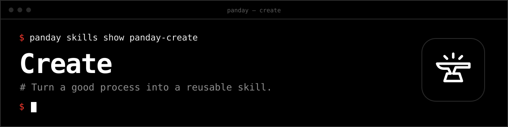

**Turn a recurring task, a useful conversation, or a document into a skill.** Create helps identify the repeatable method and express it as clear instructions with the supporting materials it needs.

Use it when you keep explaining the same process or want to share a dependable workflow. Supply examples, a checklist, a document, or the conversation that captured the method. Explain what a good result must include and what the assistant should never assume.

> Use $panday-create to turn this onboarding checklist into a skill. It should prepare a personalized first-week plan and flag any missing information about the new hire.

**You get:** a skill package with a defined purpose, actionable steps, expected outputs, appropriate resources, and planned test cases. The amount of supporting material should follow the task's needs.

Create should resolve important gaps rather than hide them in vague instructions. A newly written skill is a candidate to try and evaluate, not proof that every future result will be correct.

| Bring this | Leave with this |
| :--- | :--- |
| A recurring task, conversation, checklist, or document; representative inputs; and an example of a good result. | A reusable candidate with a trigger, instructions, expected output, necessary resources, and planned checks. |

**From useful routine to usable skill**

1. Identify the recurring need and check whether an existing skill already covers it.
2. Extract the method: what starts the task, what information is required, which decisions matter, and how missing information is handled.
3. Write actionable instructions and add supporting templates or references where they serve a real step.
4. Check the package structure and links, and define normal, incomplete-input, and boundary cases for evaluation.

<details>
<summary><strong>Worked example: a reusable weekly update</strong></summary>

**You provide:** Two sets of weekly notes, a report you liked, and the rule “never turn a tentative date into a commitment.”

**The candidate should describe:** How to separate completed work, blockers, and next steps; how to preserve source dates; and when to request clarification. Its report template gives those sections a consistent shape.

**Useful checks include:** Notes with no completed work, conflicting dates, and an unresolved blocker carried over from last week. Trying the skill on another week's notes helps reveal whether it captured your method or merely copied the examples.

</details>

[Full workflow](skills/panday-create/SKILL.md) · [Back to skill guide](#choose-the-right-skill)

---

<a id="inspect--understand-a-skill-before-trusting-it"></a>

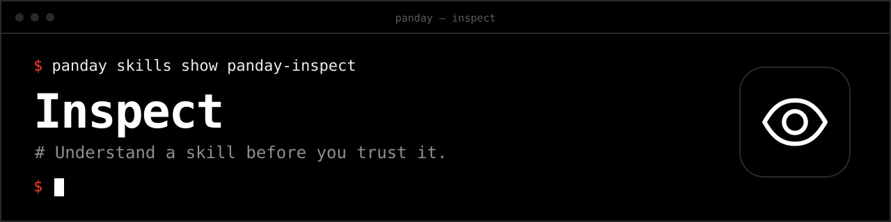

**Look beyond the description and examine what a skill actually asks your assistant to do.** Inspect reviews the source files for suspicious instructions, excessive permissions, unsafe dependencies, and other concerns.

Use it before adopting an unfamiliar package or after a meaningful source change. Give it the exact folder or repository location and explain the environment where you intend to use it.

> Use $panday-inspect to review this downloaded skill. Explain what files or services it wants to access, whether it sends information elsewhere, and anything I should resolve before installing it.

**You get:** findings tied to specific source material, their practical implications, and a clear account of what was and was not reviewed.

Inspection is read-only and does not run the candidate's scripts. It can identify concerns and missing evidence; it cannot guarantee that a package is harmless in every environment. A changed package needs a fresh review of the affected content.

| Bring this | Leave with this |
| :--- | :--- |
| The exact folder or archive, intended host, and the question you need answered before adoption. | Source-linked findings, affected files, permission and dependency concerns, and explicit review limits. |

**What gets examined**

1. Identify the package revision and inventory its instructions, scripts, references, metadata, and linked resources.
2. Read instructions in context: what actions are requested, what authority is assumed, and what information may leave the environment?
3. Review relevant code as source, along with package contents and hidden or unavailable dependencies.
4. Report supported findings and unresolved questions separately, with locations that let an owner investigate or repair them.

<details>
<summary><strong>Worked example: a downloaded report generator</strong></summary>

**Your question:** “This skill says it only formats local reports. Does the package support that description?”

**A useful finding might say:** A linked script contains an outbound upload request, identify the file and operation, and explain what input it appears to send. The report should distinguish a reachable workflow step from unused code or an uncertain dependency.

**Review limits remain visible:** If a referenced remote script is unavailable, its behavior remains unreviewed. The inspector does not run it to fill the gap. An installation decision can then account for that missing information.

</details>

[Full workflow](skills/panday-inspect/SKILL.md) · [Back to skill guide](#choose-the-right-skill)

---

<a id="evaluate--find-out-how-well-a-skill-works"></a>

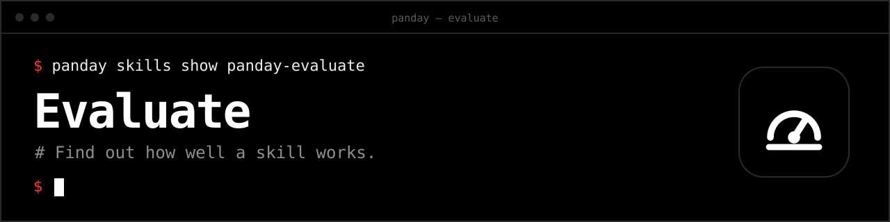

**Replace “it seems good” with examples and results you can examine.** Evaluate helps write test cases, validate evaluation files, compare outputs, interpret benchmark reports, and define quality checks.

Use it when you want to know whether a skill performs its intended task or whether a change made things better. Provide realistic inputs, your definition of success, and any existing results. Include awkward cases, not just ideal examples.

> Use $panday-evaluate to test this meeting-summary skill. Check whether it preserves decisions, avoids invented deadlines, and handles notes with no action items. Explain failures in plain language.

**You get:** appropriate cases or configuration, assessed results when execution is available, and a report separating demonstrated outcomes from missing evidence. Comparisons should account for repeated runs, incomplete results, and available time or cost data.

Writing tests is different from running them. If the required model or tools are unavailable, Evaluate should identify that gap rather than report unperformed tests as passed.

| Bring this | Leave with this |
| :--- | :--- |
| The skill revision, a decision to make, representative tasks, and any existing runs or reports. | Cases or configuration, a suitable comparison design, assessed evidence where available, and an explained verdict. |

**Choose the evaluation you actually need**

1. Define the question: validate a package, test a behavior, compare a revision, interpret a report, or apply a CI policy.
2. Specify expected outcomes before judging results. Include ordinary tasks, difficult inputs, and cases where the skill should decline or ask for information.
3. When runs are authorized and available, compare equivalent inputs under declared conditions and retain individual outputs.
4. Explain failures, incomplete cases, variation, and recorded time or token cost. Keep structural validity distinct from demonstrated task quality.

<details>
<summary><strong>Worked example: did a summary skill improve?</strong></summary>

**Decision:** Keep the current revision or adopt a revision intended to reduce invented deadlines.

**Comparison:** Run both on the same representative notes, including missing and conflicting dates. Score factual preservation and required content separately from formatting. Repeat where appropriate rather than relying on one favorable output.

**Report:** Show the examples behind failures, whether both versions completed the same cases, and any efficiency tradeoff. A policy may return **ALLOW**, **HOLD**, or **BLOCK** according to its declared thresholds. Missing required evidence supports a hold, not an invented success.

</details>

[Full workflow](skills/panday-evaluate/SKILL.md) · [Back to skill guide](#choose-the-right-skill)

---

<a id="fix--repair-a-skill-that-misses-the-mark"></a>

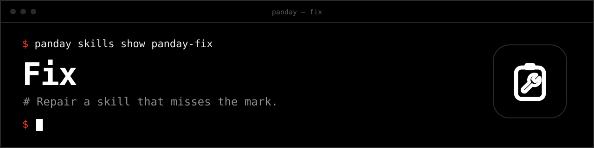

**Address a failure in what a skill is already supposed to do.** Fix starts with a reproducible problem, identifies the likely cause, and makes a targeted correction.

Use it when a skill repeatedly misses required information, violates its own instructions, produces the wrong format, or fails under a specific condition. Provide the skill, the input that exposed the problem, the actual result, and the result you expected.

> Use $panday-fix to repair this report skill. It keeps dropping unresolved blockers even though they are present in the notes. Here are two examples and the expected output.

**You get:** a supported diagnosis, a revised candidate, an explanation of the change, and regression cases that check the failure while protecting useful behavior.

Fix is for broken promises. If the existing behavior is correct and you want a new feature, choose Augment. If it works but could be more effective for a particular task, choose Optimize.

| Bring this | Leave with this |
| :--- | :--- |
| The failing revision, an input that exposes the issue, actual output, and the intended behavior. | A diagnosis, a scoped repair candidate, retained prior evidence, and checks for the failure and related regressions. |

**A repair with a reason behind it**

1. Confirm that the correct skill and revision were loaded and that missing tools or inputs did not cause the problem.
2. Reproduce or characterize the supported failure and locate the instruction, resource, or decision that causes it.
3. Preserve the predecessor and make a correction tied to that cause.
4. Recheck the failing case and representative successful uses. Explain what is demonstrated and what remains untested.

<details>
<summary><strong>Worked example: the disappearing blocker</strong></summary>

**Observed failure:** A weekly-report skill drops an unresolved blocker whenever there is no new progress on it.

**Potential cause:** Its selection rule only includes items updated during the current week, despite promising to include unresolved blockers.

**A focused repair:** Separate the “new progress” filter from the “still unresolved” filter. Recheck both the reported failure and a case where last week's blocker has since been resolved, so the repair does not keep obsolete items forever.

If the skill never promised carry-over behavior, discuss that as a capability addition through Augment instead.

</details>

[Full workflow](skills/panday-fix/SKILL.md) · [Back to skill guide](#choose-the-right-skill)

---

<a id="install--add-the-skill-you-selected"></a>

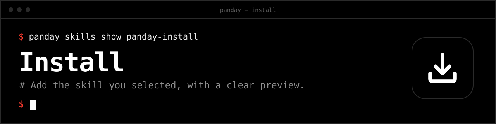

**Move a chosen skill into the right place with a clear preview of the change.** Install supports selected local packages and repository sources, including private repositories when access is available.

Use it after choosing the skill and destination. Provide the source, the specific skill if the repository contains several, and where it should be installed. You can also ask it to list skills from a supplied curated source.

> Use $panday-install to install the meeting-notes skill from this repository into my project. Show the source and destination before applying the change.

**You get:** a preview of the selected package and destination, any blockers or conflicts, and verification of the installed files after an eligible installation is applied.

The package applied must match the one reviewed for that operation. Missing authorization, unresolved findings, destination conflicts, or changed source files should be surfaced rather than silently bypassed. Private repository access uses the access available in your environment.

| Bring this | Leave with this |
| :--- | :--- |
| A selected local or repository source, the skill subfolder if needed, a named target project, and preview/apply intent. | A package and destination preview; after an eligible apply, verified installed files and an operation report. |

**Know what is being added and where**

1. Resolve the source and destination explicitly, including the revision and subpath when applicable.
2. Inspect unfamiliar packages and identify conflicts, missing evidence, or held findings that affect eligibility.
3. Preview the selected bytes and intended writes. Bind the operation to a fingerprint—a content identifier for that package.
4. Apply within the requested authority, then verify the installed content. If the source changes, refresh the preview before proceeding.

<details>
<summary><strong>Worked example: one skill from a large repository</strong></summary>

**Your request:** Install only the meeting-notes skill from a repository containing several tools into a named project.

**Preview:** Identify the chosen repository revision, exact subfolder, destination, and any existing destination folder. The operation should not expand to every sibling skill.

**After applying:** Verify that the installed bytes match the selected candidate. If an existing folder conflicts, or the candidate changes between preview and apply, report the issue instead of silently replacing content or trusting an outdated review.

</details>

[Full workflow](skills/panday-install/SKILL.md) · [Back to skill guide](#choose-the-right-skill)

---

<a id="card--make-a-skill-easy-to-understand"></a>

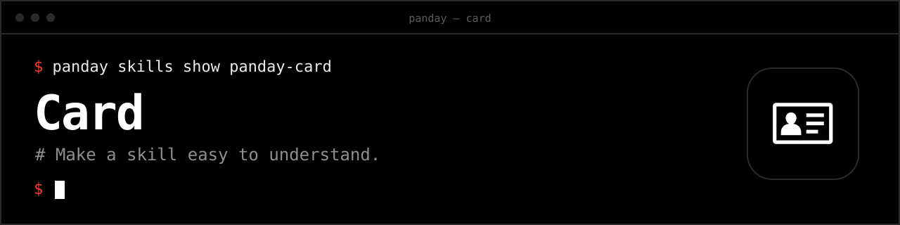

**Create a readable overview for the next person who encounters a skill.** Card summarizes its purpose, use, ownership, permissions, evidence, and known limitations from available sources.

Use it when sharing a skill, reviewing a collection, or refreshing documentation after a change. Supply the skill and any relevant evaluation results, ownership details, or review records.

> Use $panday-card to create a skill card for this customer-feedback workflow. Explain what it does, what information it uses, and which claims have actually been tested.

**You get:** a source-linked summary that helps readers understand the skill without first reading every file. Unknown or unverified details remain visible.

A card is a summary, not a certificate. It should not invent an owner, license, approval, or successful test result. The responsible owner can review it before publication.

| Bring this | Leave with this |
| :--- | :--- |
| A skill package, intended audience, card destination, and any ownership or evaluation records you want included. | A reviewable overview linked to source evidence, with known risks, missing information, and owner-review status. |

**Make a skill understandable to someone new**

1. Identify which copy and revision the card describes.
2. Extract the declared purpose, expected inputs and outputs, dependencies, and relevant permissions.
3. Summarize available inspection or evaluation evidence with its coverage and limitations.
4. Mark unknown ownership, license, review, or performance information explicitly and prepare the card for owner review.

<details>
<summary><strong>Worked example: hand a workflow to your team</strong></summary>

**Situation:** A colleague needs to know whether your customer-feedback skill suits a new project.

**The card explains:** Which feedback formats it accepts, what summary it produces, whether it depends on an external tool, where the documented owner information comes from, and which cases have actually been tried.

**Useful uncertainty:** If the package has no license statement or no evidence for multilingual inputs, those fields remain unknown or unassessed. The card should make a decision easier without making unsupported claims on the owner's behalf.

</details>

[Full workflow](skills/panday-card/SKILL.md) · [Back to skill guide](#choose-the-right-skill)

---

<a id="augment--add-something-useful"></a>

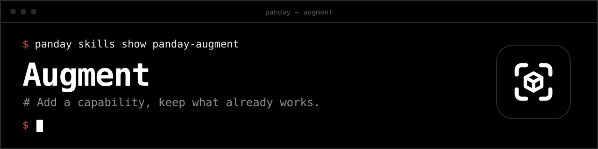

**Extend a working skill while keeping the behavior you already value.** Augment adds a justified capability and checks how it interacts with the existing workflow.

Use it when a skill does its current job but your needs have expanded. Describe the new capability, when it should apply, and what must remain unchanged.

> Use $panday-augment to add a customer-facing summary to this internal project-update skill. Keep the existing internal report and exclude confidential notes from the customer version.

**You get:** an expanded skill candidate, an explanation of the new behavior, and cases covering both the addition and the original capabilities.

Augment should make the addition explicit. It should not quietly redefine the skill's purpose or remove existing value to make room for the new feature.

| Bring this | Leave with this |
| :--- | :--- |
| A working revision, examples of successful use, the proposed addition, and existing behavior to preserve. | An extension candidate, a map of changed and retained responsibilities, compatibility notes, and targeted checks. |

**Grow a useful skill deliberately**

1. Establish the current promise and working baseline, including callers and expected output formats.
2. Decide whether the new need belongs inside the skill or would be better served by a reference or specialist handoff.
3. Add a clear branch for the new behavior and describe any new tools, dependencies, or permission implications.
4. Check the new path and repeat representative existing cases so an addition does not erase what already works.

<details>
<summary><strong>Worked example: an external version of an internal update</strong></summary>

**Existing value:** The internal report includes detailed blockers, staffing notes, and delivery risks.

**New capability:** Produce a customer-facing version when explicitly requested, using only approved information.

**What needs checking:** The original internal format still works; the new mode excludes confidential details; ambiguous audience requests prompt clarification; and the output does not silently substitute one audience's report for the other.

The extension record makes those behavior changes and checks visible to the owner.

</details>

[Full workflow](skills/panday-augment/SKILL.md) · [Back to skill guide](#choose-the-right-skill)

---

<a id="synthesize--combine-skills-without-losing-their-value"></a>

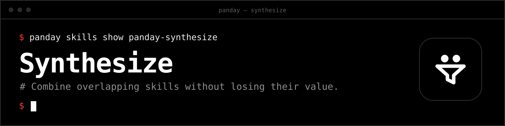

**Bring overlapping skills into one coherent skill while preserving what each contributes.** Synthesize examines the source skills before deciding how their instructions and resources fit together.

Use it when two or more skills serve a related purpose and maintaining them separately creates duplication or confusion. Supply the complete source packages and describe the capabilities you want to retain.

> Use $panday-synthesize to combine these meeting-decisions and meeting-actions skills. Preserve decision rationale, action owners, missing-deadline warnings, and both output formats where useful.

**You get:** a capability map, a combined candidate where the merge is appropriate, and checks showing how the original responsibilities are covered.

The goal is a useful combined workflow, not a shorter document. Conflicting rules need an explicit resolution. If the skills have incompatible purposes or authority requirements, keeping them separate may be the better result.

| Bring this | Leave with this |
| :--- | :--- |
| Two or more complete skill packages, the combined goal, and capabilities or constraints that must survive. | A merged candidate where appropriate, parent-to-result traceability, conflict decisions, and coverage gaps. |

**Preserve the methods behind the words**

1. Inventory each source's triggers, steps, outputs, resources, successful cases, and authority limits.
2. Identify duplicate, complementary, conflicting, and obsolete elements. Resolve material conflicts explicitly.
3. Design one coherent entry point with distinct branches where different inputs require different methods.
4. Map each material source capability to the result and retain regression cases from every parent.

<details>
<summary><strong>Worked example: decisions and actions in one meeting skill</strong></summary>

**Source A:** Captures decisions with rationale and dissent. **Source B:** Captures actions with owners, deadlines, and missing-detail warnings.

**The synthesis:** Supports a coherent meeting record while keeping separate decision and action sections. It preserves rationale, dissent, and uncertainty instead of reducing everything to a generic list of bullets.

**Coverage review:** Show where each parent's valuable behavior lives in the result. If one source requires an incompatible approval process, surface the conflict and consider keeping the skills separate through Connect.

</details>

[Full workflow](skills/panday-synthesize/SKILL.md) · [Back to skill guide](#choose-the-right-skill)

---

<a id="optimize--find-a-better-way-to-do-the-job"></a>

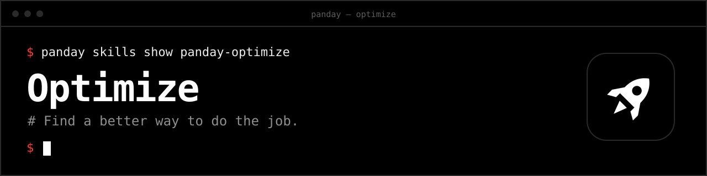

**Improve a working skill against a specific goal.** Optimize explores whether a different approach produces better results, uses less time, or reduces unnecessary work while maintaining required quality.

Use it when the skill already works but its current method may not be the best fit. Define the task, the desired improvement, and the constraints that must hold.

> Use $panday-optimize to improve this long-document review skill. I want fewer missed requirements without increasing the review time substantially. Compare the revised approach with the current one.

**You get:** a baseline, a proposed alternative, and available comparison evidence, with tradeoffs and uncertainty stated clearly.

Shorter instructions are not automatically better. An optimization that removes necessary checks or weakens the result has not met the goal. If the comparison is inconclusive, retaining the current approach is a valid outcome.

| Bring this | Leave with this |
| :--- | :--- |
| A working skill, a specific target task, baseline examples, and a goal such as fewer omissions or less time. | A diagnosed bottleneck, alternative approach, matched comparison evidence where available, and a recommendation. |

**Improve the route, then check the destination**

1. Define the task and improvement measure, plus the quality and safety constraints the new approach must retain.
2. Review traces or representative results to locate the bottleneck before rewriting instructions.
3. Compare materially different approaches, such as decision order, reference loading, or a reusable template.
4. Judge equivalent cases and broader regressions. Adopt, revise, retain the baseline, or call the evidence inconclusive.

<details>
<summary><strong>Worked example: reviewing a long requirements document</strong></summary>

**Baseline:** A single-pass review frequently overlooks requirements buried in later sections.

**Alternative:** First build a source-linked requirements inventory, then review the proposal against that inventory. The change is a different method, not simply a longer instruction.

**Comparison:** Check missed requirements, unsupported findings, completion, and recorded time across matched documents. If coverage improves but time exceeds your stated limit, explain the tradeoff instead of declaring an unconditional improvement.

</details>

[Full workflow](skills/panday-optimize/SKILL.md) · [Back to skill guide](#choose-the-right-skill)

---

<a id="connect--build-a-workflow-between-skills"></a>

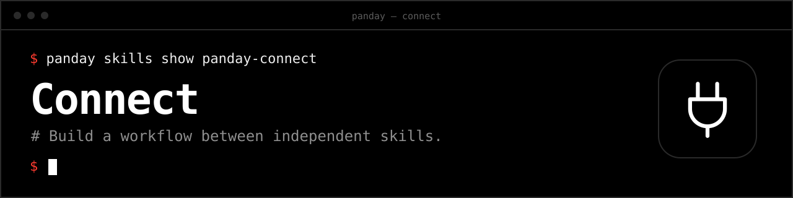

**Make independent skills cooperate without merging them.** Connect defines how one skill's output becomes another's input, what information must accompany it, and when the workflow should pause.

Use it when separate capabilities would be useful together. Provide the participating skills, the desired end result, and any review or approval points.

> Use $panday-connect to connect this interview-summary skill with this project-planning skill. The planner should use confirmed findings and pause when important requirements are still unanswered.

**You get:** a workflow with clear responsibilities, input and output expectations, handoff conditions, and handling for incomplete or unsuitable results.

The connected skills retain their independent purposes. Connecting them does not automatically grant new permissions or create a background automation service; execution still depends on your assistant and available tools.

| Bring this | Leave with this |
| :--- | :--- |
| Independent skills, the desired end result, expected order or branches, and review points. | A workflow specification with responsibilities, handoff fields, validation rules, pause conditions, and recovery behavior. |

**Make the handoff as clear as the individual task**

1. Read each skill's contract and map its inputs, outputs, prerequisites, and side effects.
2. Define the smallest useful sequence or branching workflow and name who selects each next step.
3. Specify the information crossing every handoff, including how completeness and freshness are checked.
4. Walk through normal, partial, stale, failed, and cancelled cases, including retries and duplicate runs where relevant.

<details>
<summary><strong>Worked example: research findings become a project plan</strong></summary>

**Producer:** An interview-summary skill returns confirmed findings, quotes, open questions, and source references.

**Consumer:** A planning skill accepts confirmed findings as inputs and treats open questions as unresolved dependencies.

**Handoff rule:** Required fields must be present and the findings must belong to the expected revision. An unresolved critical requirement pauses planning or produces a clearly bounded partial plan. It must not disappear merely because the next skill lacks a field for it.

Connect produces that workflow specification; running it requires an appropriate host or runner.

</details>

[Full workflow](skills/panday-connect/SKILL.md) · [Back to skill guide](#choose-the-right-skill)

---

<a id="migrate--prepare-a-skill-for-another-assistant"></a>

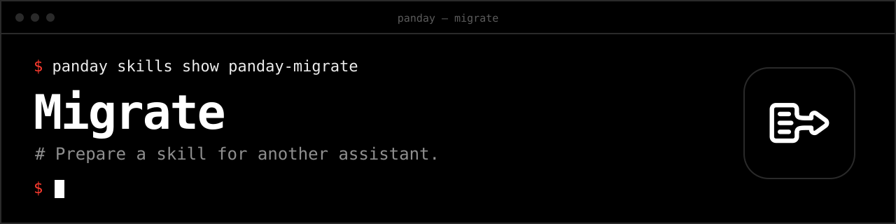

**Adapt a skill package for a supported destination without hiding what changes.** Migrate reviews the source structure and prepares the packaging and metadata required by the target host.

Use it when moving a skill between supported Codex and Claude formats. Specify the source package and destination, and identify any host-specific tools the skill relies on.

> Use $panday-migrate to prepare this skill for Claude. Preserve its instructions and resources, explain metadata changes, and flag anything that still depends on Codex-specific tools.

**You get:** a migration preview, a target package when the operation can proceed, and a report of preserved content, changes, and manual review items.

Packaging compatibility is different from identical behavior. The destination assistant may have different tools or instruction handling, so try the migrated skill in its new environment before relying on it.

| Bring this | Leave with this |
| :--- | :--- |
| The source package, named target host, destination, and any provider-specific dependencies you know about. | A compatibility inventory, conversion plan, preview or authorized target package, and a migration report. |

**Move the package with its assumptions in view**

1. Inventory instructions, metadata, invocation conventions, tools, resources, and local links while preserving the source.
2. Classify each relevant element as preserved, transformed, unsupported, or requiring an owner choice.
3. Preview destination files and apply within the requested authority, using the same package identity checked in the preview.
4. Validate structure and links, report remaining host-specific dependencies, and identify the destination checks still needed.

<details>
<summary><strong>Worked example: prepare a Codex skill for Claude</strong></summary>

**Source:** A release-notes skill includes instructions, a template, interface metadata, and a reference to a host-specific integration.

**Expected treatment:** Preserve the instructions and template, adapt supported packaging conventions, and explicitly flag the integration that needs a destination equivalent. Do not invent a tool with the same name or silently remove the dependent workflow step.

**Completion:** The report identifies changed and preserved files and any unverified host assumptions. Run a representative task in the destination host before treating the conversion as behaviorally equivalent.

</details>

[Full workflow](skills/panday-migrate/SKILL.md) · [Back to skill guide](#choose-the-right-skill)

## What this looks like in everyday work

### Turn a recurring report into a repeatable routine

Start with **Create** and provide last week's notes plus a report you liked. Use **Evaluate** on a different week to check the structure and factual accuracy. If the skill omits a required section, use **Fix** with that example. Later, use **Augment** to add a second audience or output format.

### Adopt an existing skill thoughtfully

Use **Discover** to find candidates for your task. Choose one and use **Inspect** on its exact source. Resolve any concerns, then use **Install** for the selected destination. Try it on a representative task and use **Card** to document what your team now knows about it.

### Bring several useful tools into one process

Suppose one skill summarizes research and another prepares a plan. Use **Connect** to define which findings the planner can rely on and what happens when evidence is missing. If you instead have two overlapping research skills, use **Synthesize** to explore a single combined workflow. Use **Optimize** only after you have a clear improvement target to measure.

These are examples, not a mandatory sequence. Each skill can be used independently.

## Optional command-line setup

The helper provides repeatable local checks and reports. It requires [uv](https://docs.astral.sh/uv/getting-started/installation/) and a compatible Python environment; the CLI supports Python 3.11 or newer. The Windows installer uses PowerShell. The macOS/Linux installer also needs `unzip` and either `curl` or `wget`.

### Windows

Run in PowerShell:

```powershell
irm https://raw.githubusercontent.com/GG-Santos/panday/main/install.bat -OutFile install.bat
.\install.bat
```

### macOS and Linux

```sh
curl -fsSL https://raw.githubusercontent.com/GG-Santos/panday/main/install.sh -o install.sh
sh install.sh
```

The installers currently download bundle **v1.1.2**, install the local helper, and initialize its configuration. The default package location is `%LOCALAPPDATA%\Panday` on Windows and `${XDG_DATA_HOME:-$HOME/.local/share}/panday` on macOS/Linux. Use `PANDAY_HOME` to choose another location.

Check the installation:

```sh
panday --version
panday doctor
```

To make the downloaded skill folders visible to the helper, add their location to `~/.panday/config.toml` (on Windows, `%USERPROFILE%\.panday\config.toml`):

```toml
version = 1

[registries]
paths = ["/absolute/path/to/panday/skills"]
```

Replace the example path with your actual extracted `skills` folder. This registers folders with the helper; follow your assistant's own installation process to activate the skills in chat.

Useful first commands:

```sh
panday skills list
panday skills show panday-create
panday eval validate /path/to/a/skill
```

The helper validates files, summarizes recorded results, and supports package operations. It does not run model evaluations or execute candidate skill scripts. The bundle and helper have separate version numbers, so their version strings may differ.

See the [CLI reference](cli/README.md) for commands, configuration, private-source access, reports, and exit codes. See the [lifecycle resources](lifecycle/) for optional records used when skills hand work to one another.

## Frequently asked questions

### Is Panday an AI assistant?

No. It provides skills for an assistant that supports them. Your host supplies the model, chat interface, and tools. Panday guides how that assistant carries out particular skill-related tasks.

### Do I need all 12 skills or the command-line helper?

No. Start with the skill that solves your immediate problem. Each has its own workflow and can operate without the optional shared helper. Some tasks still require files, tools, network access, or a model runner appropriate to the work.

### Do I need to know how to code?

You can describe tasks and review outputs in ordinary language. Installing skill folders may require a little familiarity with your assistant's setup. Script development, automated evaluations, and command-line integrations are more technical and optional for everyday use.

### Does installing Panday give my assistant access to everything?

Access comes from the host and the tools you authorize. A skill package does not replace those controls. Review the intended source, destination, and permissions for operations that read, write, install, or use external services.

### Are files uploaded somewhere automatically?

The local helper does not itself run model tasks. Your AI assistant's handling of the material you share depends on that host and its configuration. Discovery and repository downloads use network services when invoked; other integrations depend on the tools used in the task. Review those settings before providing sensitive material.

### Does using a skill guarantee a correct result?

No. Instructions help structure work, but results still depend on the model, inputs, tools, and task. Use representative examples, retain failures, and evaluate important changes. A structural check or a successful example is not proof of universal reliability.

### Which should I choose: Fix, Augment, or Optimize?

Choose **Fix** when promised behavior is failing. Choose **Augment** when you want an additional capability. Choose **Optimize** when the existing behavior works and you want a better method for a defined task.

### How are Synthesize and Connect different?

**Synthesize** creates one skill from multiple source skills. **Connect** keeps the skills separate and defines how they cooperate. Choose based on whether you want one combined capability or a workflow between independent capabilities.

### Will migration make a skill behave exactly the same elsewhere?

No. Migration adapts supported packaging and metadata and identifies remaining dependencies. Test the resulting skill in the destination host to assess its behavior there.

### What will it cost to use?

Your model subscription, API usage, and connected services determine execution costs. Evaluation can involve repeated model runs. Ask for a bounded test plan when cost or time matters; the helper cannot infer monetary cost when it has not been recorded.

## Help shape Panday

Found a confusing instruction, a broken installation step, or a task a skill handles poorly? [Open an issue](https://github.com/GG-Santos/panday/issues) with the skill name, what you expected, what happened, and a small example with private information removed.

For improvements, include the intended behavior and an example that would demonstrate it. Changes to instructions are easier to assess when they come with realistic cases, including failures and missing information. [Pull requests](https://github.com/GG-Santos/panday/pulls) are welcome.

Browse the [skill source](skills/), read the [CLI documentation](cli/README.md), or [download the latest packaged release](https://github.com/GG-Santos/panday/releases/latest).
